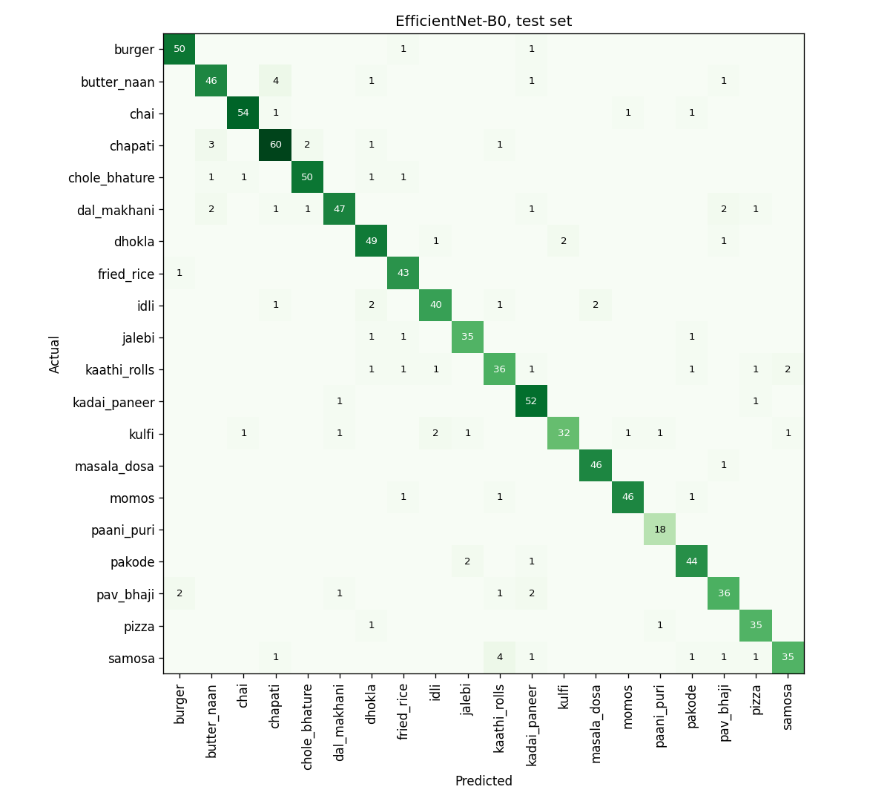

# NutriScan: Food Photo to Nutrition (Indian dishes)

Take a photo of your plate. NutriScan recognises the dish with a CNN and shows calories, protein, carbs, fat, fibre, vitamins and minerals for your portion, using the **Indian Nutrient Databank (INDB)**.

**Live demo:** https://nutriscan-food-nutrition.onrender.com (free server, the first visit can take about a minute to wake up)


## Why I built this

Calorie apps are built around Western food and packaged labels. For a plate of dal makhani or a masala dosa you usually have to guess. I wanted to combine an image model with a proper Indian food composition database, and be honest about where the numbers come from.

## Results

Dataset: [Indian Food Images](https://huggingface.co/datasets/rajistics/indian_food_images), 20 dishes. 4,795 images for training, 533 for validation, 941 for the test set. Trained on a free Colab T4 GPU; the notebook is saved with its outputs.

| Model | Test accuracy | Top-3 accuracy | Macro F1 |
| --- | --- | --- | --- |
| Small CNN, trained from scratch | 0.694 | 0.884 | 0.673 |
| **EfficientNet-B0, transfer learning** | **0.908** | **0.961** | **0.907** |

Transfer learning wins by a wide margin. With fewer than 5,000 photos, a network that has already learned edges, textures and shapes from ImageNet needs far less data than one that starts from nothing. The small CNN was still improving after 15 epochs, but at about two minutes per epoch it would need many more to catch up.

- The right dish is in the top 3 for 96% of test photos, which is why the app shows three guesses and lets you pick.
- Best classes: masala dosa (F1 0.97), chai (0.96), burger (0.95). Weakest: kaathi rolls (0.82), samosa (0.85), pav bhaji (0.86). The biggest confusions make sense: 4 samosas were called kaathi rolls (both are brown, folded and fried), and butter naan and chapati were mixed up 7 times.
- The ONNX export gives the same output as PyTorch (largest difference 0.000008) and the file is 16 MB.



## How it works

```
photo ─► resize 256, centre crop 224 ─► EfficientNet-B0 (fine-tuned, ONNX) ─► top-3 dishes
                                                                                   │
                         user can correct the dish if the guess is wrong ◄──────────┘
                                                                                   │
           INDB recipe (per 100 g) × portion in grams ─► energy, macros, 7 minerals, 9 vitamins
```

1. **Recognise.** EfficientNet-B0 pre-trained on ImageNet, fine-tuned on 20 dishes (first two epochs train only the new classifier head, then the whole network). Compared with a small CNN trained from scratch.
2. **Look up.** Each dish is matched to one INDB recipe. `scripts/build_nutrition.py` builds the table.
3. **Scale.** Values are per 100 g, scaled to the portion. The default is INDB's standard serving.

The model is exported to ONNX, so the web server runs it with ONNX Runtime and does not need PyTorch. That keeps the app small enough for a free server.

## Data problems I found (and how I handled them)

- **Deep-fried dishes have impossible fat values in INDB.** Samosa comes out at 59 g fat per 100 g, bhatura at 83 g, mixed pakora at 72 g. INDB counts all the oil used in the recipe, including oil that stays in the pan. Any recipe above 40 g fat per 100 g is marked unreliable and the app shows a note instead of wrong numbers. Affected: samosa, pakode, chole bhature, burger.
- **Three dishes are not in INDB:** jalebi, momos and paani puri. The model still recognises them; the app says that nutrition data is missing.
- **Some standard servings look large** (for example INDB's pizza "slice" is 297 g), so the app lets you set the portion in grams.
- A test checks that energy roughly matches 4 kcal/g protein + 4 kcal/g carbs + 9 kcal/g fat for every dish shown.

## Limitations

- The nutrition is for a standard recipe. Home cooking, extra ghee or oil can change it a lot.
- One dish per photo. A thali will be labelled as one dish.
- Only 20 dishes, and the training photos come from web search, so restaurant-style photos work better than dim home photos.

## Project structure

```
nutriscan/
  model.py       image preprocessing + ONNX Runtime inference
  nutrition.py   portion scaling using the INDB table
  api.py         FastAPI app: /api/analyze, /api/nutrition/{dish}, /api/dishes, /api/model, /health
notebooks/
  train_food_classifier.ipynb   training on Colab: small CNN vs EfficientNet-B0, evaluation, ONNX export
scripts/
  build_nutrition.py            builds models/nutrition.json from INDB.xlsx
models/          ONNX model, labels, metrics, nutrition table
static/          front end (HTML, CSS, JavaScript)
tests/           pytest tests, run on GitHub Actions
```

## Run it locally

```bash
python -m venv .venv
source .venv/bin/activate        # Windows: .venv\Scripts\activate
pip install -r requirements.txt
uvicorn nutriscan.api:app --reload
```

Open http://127.0.0.1:8000, or try the API:

```bash
curl -F "image=@my_dosa.jpg" http://127.0.0.1:8000/api/analyze
```

## Retrain

Open `notebooks/train_food_classifier.ipynb` in Google Colab with a GPU and run all cells (about 20 minutes). It downloads `model_files.zip`; unzip it into `models/` and `reports/`.

To rebuild the nutrition table, download `INDB.xlsx` from the INDB repository and run:

```bash
pip install -r requirements-dev.txt
python scripts/build_nutrition.py INDB.xlsx
```

## Data and credit

- Images: [rajistics/indian_food_images](https://huggingface.co/datasets/rajistics/indian_food_images) on Hugging Face (from the Kaggle "Indian Food Classification" dataset), 20 classes.
- Nutrition: Indian Nutrient Databank, Jaacks LM et al. (2024), *Development of an Indian Food Composition Database*, Current Developments in Nutrition. Code and data: https://github.com/lindsayjaacks/Indian-Nutrient-Databank-INDB-

## Tech

Python, PyTorch, torchvision, ONNX, ONNX Runtime, Pillow, FastAPI, pandas, HTML/CSS/JavaScript, pytest, GitHub Actions, Render.
